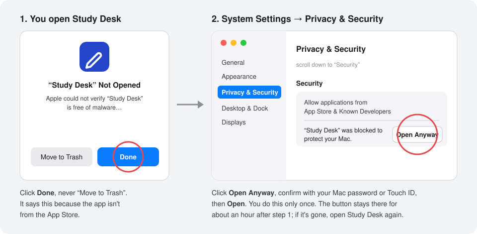

# Study Desk

A study tracker for INTO Manchester foundation-year students, on your own Mac. It downloads your course files from IntoStudy, reads your timetable, class news and homework from Compass, lays out your programme week by week (topics, assessments, exams, breaks), and gives every topic an AI tutor, lessons, tests and revision notes. Works for any subjects: science, business, sociology, global studies, English.

## Install (Mac, Intel or Apple silicon, macOS 12 or newer)

1. **Download** `Study-Desk-….zip` from [the latest release](https://github.com/akylbek10/study-desk-share/releases/latest) and double-click it. Drag **Study Desk** into **Applications**.
2. **Open** Study Desk. The first time, macOS stops it because it isn't from the App Store: click **Done**, open **System Settings → Privacy & Security**, scroll down and click **Open Anyway**, then confirm. Only once.

   

3. **Follow the guide.** The first start takes a few minutes (Study Desk installs what it needs), then the setup guide opens in your browser: your name, the AI engine (free, with a Google account), IntoStudy, Compass, and your programme. You sign in to each service yourself; Study Desk never sees your passwords.

You need: internet, a Google account, your university Microsoft account, and Google Chrome. Compass only lets real browsers in, so Study Desk reads it through a small helper extension in your own Chrome (the guide shows how to add it; one minute). Without Chrome you can add your timetable from a screenshot.

**Updates:** Settings → Check for updates. Your data stays where it is.
**Your data** lives only on your Mac, in `~/Library/Application Support/Study Desk`. AI requests go to Google (Antigravity or your Gemini key).
**Uninstall:** drag Study Desk to the Bin, delete the folder above and `~/Library/LaunchAgents/com.studydesk.app.plist`, then restart the Mac.

---

## По-русски

1. Скачай `Study-Desk-….zip` из [последнего релиза](https://github.com/akylbek10/study-desk-share/releases/latest), открой его и перетащи **Study Desk** в **Программы**.
2. Открой Study Desk. В первый раз macOS не даст его открыть, потому что он не из App Store: нажми **Готово**, открой **Системные настройки → Конфиденциальность и безопасность**, пролистай вниз и нажми **Всё равно открыть**, подтверди паролем. Это один раз (картинка выше).
3. Первый запуск занимает несколько минут, потом в браузере откроется помощник настройки: имя, ИИ (бесплатно, через Google-аккаунт), IntoStudy, Compass и твоя программа. Входишь везде сам, пароли Study Desk не видит. Для Compass нужен Google Chrome: Study Desk читает его через маленькое расширение в твоём Chrome (помощник покажет, как его добавить).

Running from source (developers): `cd study-app && uv run python server.py`, then open http://127.0.0.1:8890. Build the app with `study-app/macapp/build.sh`.
